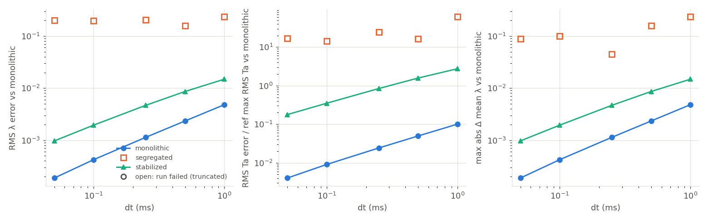
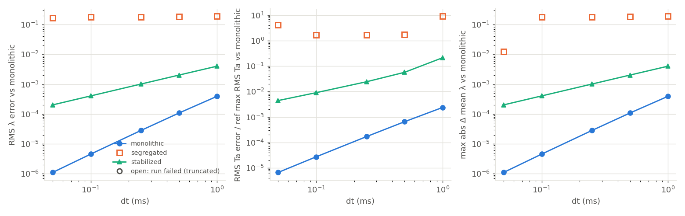
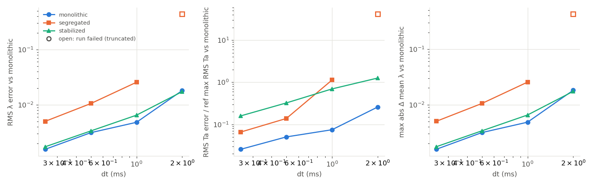
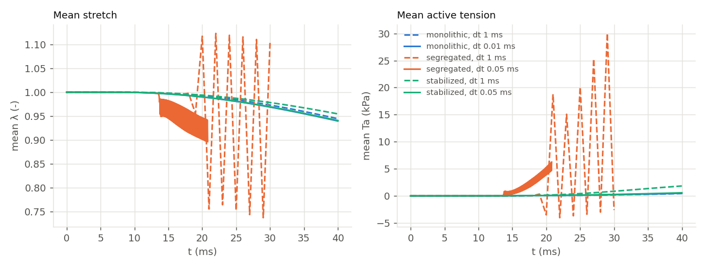
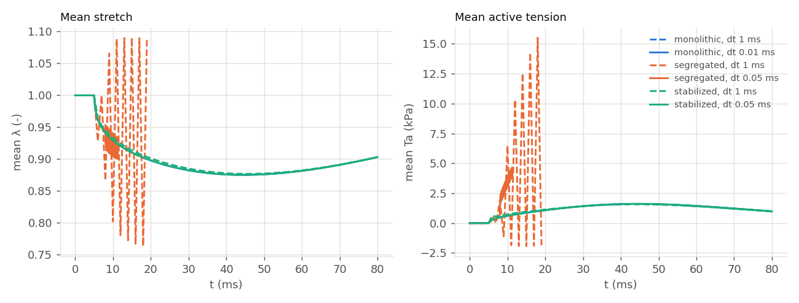
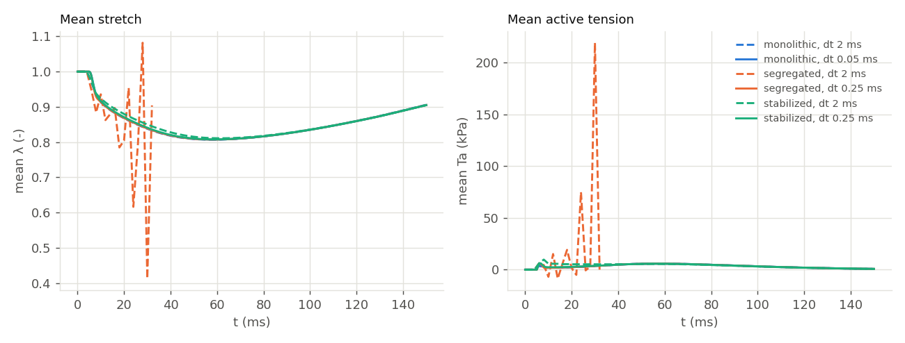

# Comparing the coupling schemes

The three coupling schemes of [tutorial 2](https://computationalphysiology.github.io/simcardemsx/coupling-schemes-0d/),
compared on the same problems at several time steps:

- **monolithic**: the contraction model stepped inside the mechanics Newton iteration;
- **segregated**: the naive staggered scheme, which is not convergent once the active
  stiffness exceeds the passive stiffness;
- **stabilized**: segregated plus Regazzoni & Quarteroni's consistent stabilization
  term.

## The scripts

| Script | What it does |
| --- | --- |
| [`element.py`](https://github.com/ComputationalPhysiology/simcardemsx/blob/main/examples/scheme_comparison/element.py) | One-element studies with prescribed inputs and no EP: `static-caisplit`, `static-zetasplit` and `dynamic-zetasplit`, each against a monolithic reference at a much smaller time step |
| [`run.py`](https://github.com/ComputationalPhysiology/simcardemsx/blob/main/examples/scheme_comparison/run.py) | Runs the [slab](https://github.com/ComputationalPhysiology/simcardemsx/tree/main/examples/slab) or [BiV](https://github.com/ComputationalPhysiology/simcardemsx/tree/main/examples/circulation_biv) under every scheme and time step, one subprocess per run, into `<root>/<geometry>/<split>/<scheme>/dt<dt>/`. A re-run skips the runs that finished |
| [`report.py`](https://github.com/ComputationalPhysiology/simcardemsx/blob/main/examples/scheme_comparison/report.py) | Reads such a folder of runs and writes `report.md` and figures: the error of each run against the monolithic reference, and the observed orders of convergence |
| [`record.py`](https://github.com/ComputationalPhysiology/simcardemsx/blob/main/examples/scheme_comparison/record.py), [`metrics.py`](https://github.com/ComputationalPhysiology/simcardemsx/blob/main/examples/scheme_comparison/metrics.py) | The per-step recorder the slab and BiV write `steps.csv` with, and the error metrics |

## Running

```bash
cd examples/scheme_comparison
python3 element.py --output-dir results
python3 run.py --study slab --root results
python3 report.py --root results
```

`run.py --dry-run` lists the runs without starting them. The naive scheme is expected
to fail on some runs, and its failures are part of the result.

## Results

The three one-element studies (`static-caisplit`, `static-zetasplit` and
`dynamic-zetasplit`) were run at several time steps under every scheme, each against a
monolithic reference at a smaller step, in about 90 s:

```bash
cd examples/scheme_comparison
python3 element.py --output-dir output
python3 report.py --root output --media media
```

`report.py --media` copies each group's error-against-dt and time-series figures into
`media/` and writes `media/provenance.json`: the git commit and whether the tree was
dirty, the library versions, the command, the date, and the `run.json` of every run (the
one-element runs have no `config.resolved.toml`). The figures were computed locally, not by CI.

- In the two static studies the naive `segregated` scheme fails at every dt: Newton stops
  converging between 11 and 31 ms, and its open squares are those runs, truncated where they
  failed.
- In the dynamic study it fails only at dt 2 ms (at 34 ms). At 1, 0.5 and 0.25 ms it completes
  and converges at about first order (observed orders of the RMS λ error 1.28 and 1.07; at
  0.5 and 0.25 ms its Ta error is even below `stabilized`'s). Inertia and damping add
  η/dt + ρL²/dt² to the stiffness a step sees, 75, 200 and 600 kPa at dt 2, 1 and 0.5 ms,
  against a peak active stiffness of 464–495 kPa (the regime of the D2 gate in
  `tests/test_dynamic_coupling.py`), and so hide the instability at small dt.
- `stabilized` completes every run and converges at about first order (RMS λ orders 0.79 to
  1.01 in the static studies, 0.95 in the dynamic one at its smallest steps).
- `monolithic` is the most accurate, partly by construction: the reference is a monolithic run
  at a smaller dt.

See the [single-element tutorial](https://computationalphysiology.github.io/simcardemsx/single-element/)
for the one-element problem.

Error against the monolithic reference, against dt (left to right: RMS λ, RMS Ta,
maximum of the mean λ difference):





Mean λ and mean Ta in time:





The slab and BiV studies (`run.py --study slab` and `--study biv`, 30 and 12 runs, the
dt 0.05 ones taking hours) are not run here, so they have no figures.
