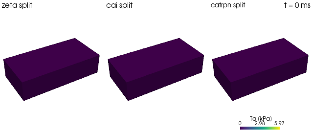
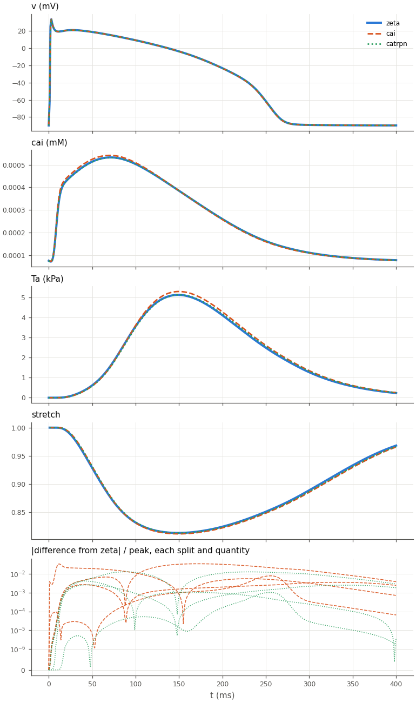

# Electro-mechanics on a slab

[`main.py`](https://github.com/ComputationalPhysiology/simcardemsx/blob/main/examples/slab/main.py)
couples EP and mechanics on a 2 × 1 × 0.5 mm slab of tissue (dx 0.5 mm), on one mesh for
EP and mechanics. The cell model is ToR-ORd + Land, composed at first run and split three
ways; the coupling scheme and the contraction model are chosen on the command line, and the
run writes its results for ParaView, checkpoints, and restarts. The
[coupled slab tutorial](https://computationalphysiology.github.io/simcardemsx/coupled-slab/)
builds a slab by hand, step by step; this is the program.

## Results

The same beat, run with each of the three splits of the composed model. The slabs are warped
by the displacement and colored by the active tension `Ta`, on one color range:





Made by `python3 compare_splits.py --media` (400 ms, `--dt-mech 1`), at commit `3d4b61c`
with the script and this README uncommitted at the time (`provenance.json` records
`git_dirty`, the versions and each run's settings). **Computed locally, not by CI.**

The splits are not the same model solved three times, but three ways of cutting one model, with
different things crossing between EP and mechanics, so they differ numerically. Measured, as the
largest `|x − x_zeta| / max|x_zeta|` over time of each volume mean:

| split | `v` | `cai` | `Ta` | stretch |
| --- | --- | --- | --- | --- |
| `cai` | 8.0e-3 | 3.4e-2 | 3.5e-2 | 3.6e-3 |
| `catrpn` | 1.0e-3 | 4.2e-3 | 1.3e-2 | 2.6e-3 |

The splits agree to within a few percent of the peak in `Ta` and `cai` (the Ca_i split's `Ta`
peaks visibly higher), within 0.4% in the stretch and within 1% in `v`. Which split to use
is a numerical choice, not a modelling one, and the differences above are its size on this slab.
They are measured on volume means of one 400 ms beat, not a bound for other geometries.

## The composed model

`main.py --split {zeta,cai,catrpn}` (default `zeta`) composes ToR-ORd and Land 2017 from
[odezoo](https://github.com/ComputationalPhysiology/odezoo) with gotranx and splits the result at the
`mechanics` component. **The first run needs network access** to fetch the two models (pinned
by version in `examples/odefiles/composed.py`, which also holds the Land calibration); odezoo
caches them afterwards, and the generated code is cached in `generated_odes/`. The composed `.ode`
files go to the gitignored `examples/odefiles/composed/`: ToR-ORd's CellML is GPL-3.0 and is not
committed here. `--odefile` runs a hand-made `.ode` file instead and excludes `--split`. The
[composed two-way coupling tutorial](https://computationalphysiology.github.io/simcardemsx/composed-two-way-coupling/)
explains the composition and the splits.

What crosses between EP and mechanics, as `resolve()` finds it (measured by `compare_splits.py`):

| split | EP → mechanics | mechanics → EP | stretch to EP |
| --- | --- | --- | --- |
| `zeta` | `S`, `W` | `Zs`, `Zw` | yes |
| `cai` | `cai` | `J_TRPN` | yes |
| `catrpn` | `CaTRPN` | none | yes |

The loop took 37.5 s (`zeta`), 36.7 s (`cai`) and 35.9 s (`catrpn`) for the 400 ms.

## Running

```bash
cd examples/slab
python3 main.py                                   # composed zeta split, monolithic, 400 ms, dt 1 ms
python3 main.py --split cai --scheme stabilized
python3 main.py --odefile ../odefiles/ToRORd_dynCl_endo_caisplit.ode \
    --crossbridge Land2017 --scheme stabilized --dt-mech 1
python3 post.py --output-dir output/torord_land_zeta
python3 post.py --output-dir output/torord_land_zeta --media   # media/slab.gif
python3 compare_splits.py --media                 # the three splits, the figure and the table
```

`compare_splits.py [--overwrite] [--media] [--t-end 400] [--dt-mech 1]` runs `main.py` and
`post.py` for each split into `output/splits/<split>/` (skipping runs that are done), writes
`output/splits/splits.png`, prints the table above, and with `--media` writes `media/`.

| Option | Meaning |
| --- | --- |
| `--split` | `zeta` (default), `cai` or `catrpn`: the composed ToR-ORd + Land, split this way |
| `--ep` | `monodomain` (default), `re+` or `re-`: reaction-eikonal EP with or without the monodomain PDE |
| `--odefile` | A hand-made `.ode` file instead of `--split` |
| `--scheme` | `monolithic` (default), `stabilized` or `segregated` |
| `--crossbridge` | `Land2017`, `RDQ18`, `RDQ20MF` or `Lewalle2024`; needs the Ca_i split and `--scheme stabilized` or `segregated` |
| `--sl-ref` | Reference sarcomere length in µm (required for `RDQ18`) |
| `--dt-mech`, `--t-end` | Mechanics time step and end time, in ms (defaults 1 and 400) |
| `--output-dir` | Where the results go (default `output/torord_land_<split>/`, or `output/<odefile stem>/`) |
| `--save-every`, `--save-every-ep`, `--checkpoint-every` | Output intervals, in ms |
| `--restart`, `--overwrite` | Continue from the checkpoint in the output folder, or replace its results |
| `--snapshot-every` | Field snapshots for the scheme comparison, in ms |

The model of the run:

- **EP**: beat's monodomain model on P1, with the EP half of the split. A stimulus current
  in one corner starts the action potential, and the cell model's own stimulus is switched
  off. With `--ep re+` or `--ep re-` it is beat's reaction-eikonal EP instead (below).
- **Mechanics**: pulse's quasistatic problem, Holzapfel-Ogden and incompressible, with
  rollers on the three faces through the origin.
- **Activation**: `GeneratedActivation` of the split's `mechanics` component, or, with
  `--crossbridge`, a crossbridge model through `CrossbridgeSegregated`.

The slab is generated with cardiac-geometriesx on first use, into `meshes/`.

## Reaction-eikonal EP

`--ep re+` and `--ep re-` replace the PDE stimulus by activation times from an eikonal
solve, from the stimulus box at a fixed delay, with conduction velocities along the
fibre, sheet and normal directions (`CV_F`, `CV_S`, `CV_N` in `main.py`, measured
on a fine (dx 0.1 mm) slab of the same conductivities, because the default dx 0.5 mm leaves
too few nodes past the stimulus box, while the delay comes from the default slab, with the
method in a comment there). Each node's cell
model is driven by beat's foot current at its activation time. `re+` keeps the
monodomain PDE (without a stimulus) and `re-` has none, so its `timings.json` has
`ep_pde_s` equal to 0.

`--ep` is physics, as are the eikonal settings: `config.resolved.toml` records them, and
a restart with another `--ep` is refused like one with another `--scheme`.
A checkpoint written before `--ep` existed cannot be restarted after it: the physics hash
gained the `--ep` and eikonal settings for every mode, the default `monodomain` too, so
such a run must start afresh.

## Output

In `--output-dir`:

- `results.h5`: `v` and `cai`, and `u`, `lmbda`, `tension_kPa` and `stiffness_kPa`;
- `log.csv`: one row per mechanics step, with the Newton iterations, mean stretch and
  mean tension;
- `restart.h5` and `restart.json`: the checkpoint that `--restart` continues from;
- `config.resolved.toml`, `run.json` and `timings.json`: the settings, how the run
  ended, and where the time went.

`post.py` writes `post/`: `fields.bp` (everything on P1, for ParaView), traces at a
corner and as volume means, and plots.

A restart may change the run's length and output options, but not its physics. A
restart with another `--scheme`, for example, is refused.
